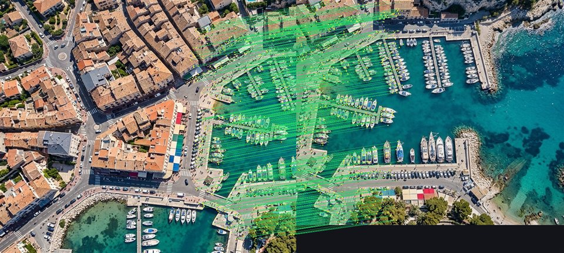
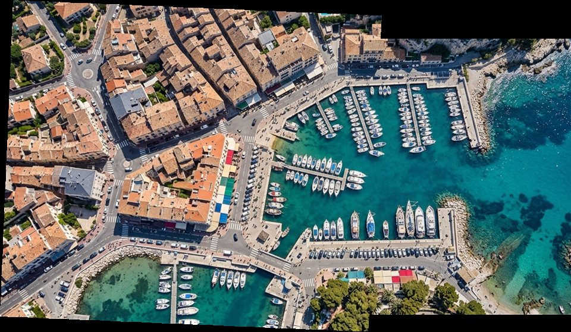

# pure-sift

[](https://github.com/dannkkie/pure-sift/actions/workflows/ci.yml)
[](LICENSE-MIT)
[![Rust: #![forbid(unsafe_code)]](https://img.shields.io/badge/rust-%23!%5Bforbid(unsafe__code)%5D-success.svg)](src/lib.rs)

A **100% pure-Rust**, zero-`unsafe` (`#![forbid(unsafe_code)]`) computer vision engine, CLI, visual catalog indexer, and Axum HTTP workbench implementing **SIFT** (*Scale-Invariant Feature Transform*, expired patent `US6711293B1`), **2D Similarity RANSAC**, and **4-Point DLT Planar Homography RANSAC**.

Zero C/C++ FFI, zero OpenCV/CMake/LLVM build dependencies — compiles cleanly to static binaries, Docker sidecars, mobile targets, and WebAssembly (`--no-default-features` omits `axum`/`tokio`).


*636 geometric RANSAC inliers matched across rotated, scaled aerial tiles (`pure-sift visualize-matches`).*


*Planar 3x3 Homography alignment and feather-blended stitch (`pure-sift align`).*

---

## Core Capabilities

* **Scale-Space DoG Keypoints ([`src/pipeline.rs`](src/pipeline.rs)):** Separable Gaussian pyramid, Difference-of-Gaussians, Hessian edge filtering, and 3D Taylor sub-pixel / sub-scale extremum refinement (`< 0.12 px` localization on smooth Gaussian blobs).
* **Canonical Orientation & 128-D SIFT Descriptors:** `>= 80%` secondary orientation peak splitting + Rayon-parallelized 128-D descriptor extraction.
* **Geometric Verification & Alignment:** Lowe ratio matching, 2D Similarity RANSAC, horizon-guarded 4-point DLT 3x3 Homography estimation (`estimate_homography_ransac`), and bilinear inverse-mapped feather-blended stitching ([`src/visualize.rs`](src/visualize.rs)).
* **Visual Catalog Search ([`src/catalog.rs`](src/catalog.rs)):** 128-bit `XOR + POPCNT` coarse Hamming shortlisting followed by exact 128-D L2 + geometric RANSAC verification.
* **CLI + Optional Single-Binary Web UI ([`src/main.rs`](src/main.rs), [`src/web_ui.html`](src/web_ui.html)):** Drop-in Axum API and embedded 3-tab browser workbench (`Keypoints & Descriptors`, `Match & Stitch Alignment`, `Visual Catalog Search`).

---

## Quick Start

### Use as a Rust Library

Add `pure-sift` to your `Cargo.toml` (use `default-features = false` for WASM, mobile, or library-only builds without `axum`/`tokio`):

```toml
[dependencies]
pure-sift = { version = "0.1", default-features = false }
image = "0.25"
```

```rust
use image::ImageReader;
use pure_sift::{
    DEFAULT_CONTRAST_THRESHOLD, DEFAULT_MATCH_RATIO, DEFAULT_RANSAC_REPROJ_THRESHOLD,
    estimate_homography_ransac, extract_sift_features, luma_to_array2, match_descriptors,
};

fn main() -> Result<(), Box<dyn std::error::Error>> {
    let q_luma = ImageReader::open("query.jpg")?.decode()?.into_luma8();
    let t_luma = ImageReader::open("target.jpg")?.decode()?.into_luma8();

    let q_feats = extract_sift_features(&luma_to_array2(&q_luma), 3, 3, DEFAULT_CONTRAST_THRESHOLD);
    let t_feats = extract_sift_features(&luma_to_array2(&t_luma), 3, 3, DEFAULT_CONTRAST_THRESHOLD);

    let matches = match_descriptors(&q_feats, &t_feats, DEFAULT_MATCH_RATIO);
    let (inliers, homography) =
        estimate_homography_ransac(&matches, DEFAULT_RANSAC_REPROJ_THRESHOLD);

    println!("RANSAC Homography inliers: {} / {}", inliers.len(), matches.len());
    if let Some(h) = homography {
        println!("3x3 Homography matrix: {:?}", h.matrix);
    }
    Ok(())
}
```

### Run the Embedded Web UI & HTTP Microservice
```bash
cargo run --release -- serve --bind 127.0.0.1:3000
# Open http://127.0.0.1:3000/ in your browser
```

### Use as a CLI Tool
```bash
# Build release binary
cargo build --release

# Extract DoG keypoints & 128-D SIFT descriptors
./target/release/pure-sift extract image.jpg --descriptors --pretty -o features.json

# Match features & estimate 2D Similarity + 3x3 Homography transforms
./target/release/pure-sift match query.jpg target.jpg --pretty -o matches.json

# Render keypoint overlay or side-by-side inlier matches
./target/release/pure-sift visualize image.jpg -o keypoints.png
./target/release/pure-sift visualize-matches query.jpg target.jpg -o matches.png

# Warp & feather-blend query onto target via Homography
./target/release/pure-sift align query.jpg target.jpg -o aligned.png

# Build and query a 128-bit Hamming + RANSAC visual catalog
./target/release/pure-sift catalog-build ./photos -o catalog.json
./target/release/pure-sift catalog-search catalog.json probe.jpg --pretty
```

---

## HTTP API Endpoints

* `GET /` — Embedded interactive HTML/JS SIFT & RANSAC workbench
* `GET /health` — JSON readiness probe
* `POST /api/v1/process-features` — Extract keypoints (and optional 128-D descriptors)
* `POST /api/v1/match-features` — Match two images + Similarity & Homography transforms
* `POST /api/v1/visualize-features` — Keypoint scale/orientation overlay PNG
* `POST /api/v1/align-images` — Stitched homography warp (`mode=stitch`) or match lines (`mode=matches`) PNG
* `GET /api/v1/catalog` | `POST /api/v1/catalog/index` | `POST /api/v1/catalog/search`

---

## Benchmarks & Specification

* Full mathematical derivation & `US6711293B1` compliance notes: [`patent_analysis.md`](patent_analysis.md)
* Real-camera validation benchmarks tested with `pure-sift`:
  * **Object in Clutter (`box.png` vs. `box_in_scene.png`):** `17/22` Similarity inliers, `18/22` Homography inliers
  * **Oxford VGG 3D Viewpoint Tilt (`graf1.png` vs. `graf3.png`):** `52/103` (`50.5%`) Homography inliers vs. `11/103` rigid-only Similarity
  * **10-MP DSLR Panorama (`boat1.jpg` vs. `boat2.jpg`, `3888x2592`):** `470/617` (`76.2%`) Homography inliers stitched to `5411x2998`

---

## License

Dual-licensed under either of:

* Apache License, Version 2.0 ([`LICENSE-APACHE`](LICENSE-APACHE))
* MIT License ([`LICENSE-MIT`](LICENSE-MIT))

at your option.
