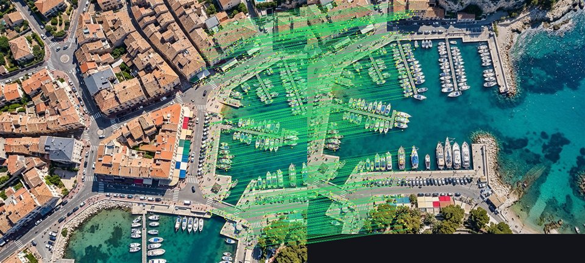
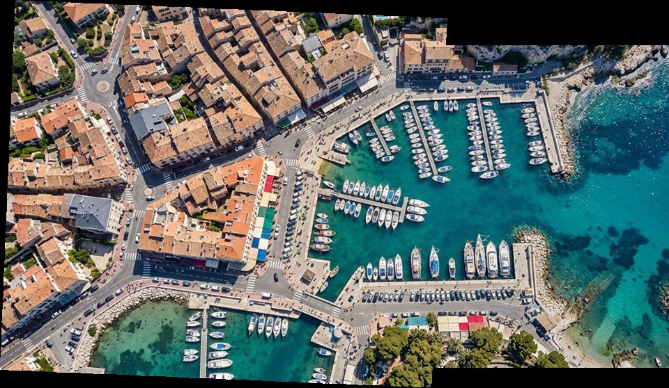

# pure-sift

[](https://github.com/dannkkie/pure-sift/actions/workflows/ci.yml)
[](https://dannkkie.github.io/pure-sift/)
[](LICENSE-MIT)
[![Rust: #![forbid(unsafe_code)]](https://img.shields.io/badge/rust-%23!%5Bforbid(unsafe__code)%5D-success.svg)](src/lib.rs)

> **[Try the Live In-Browser WebAssembly Demo →](https://dannkkie.github.io/pure-sift/)** — drag and drop two images to run SIFT feature extraction, RANSAC matching, and homography stitching 100% locally in your browser (no Rust install or server upload required).

A **100% pure-Rust**, zero-`unsafe` (`#![forbid(unsafe_code)]`) computer vision engine, CLI, visual catalog indexer, and Axum HTTP workbench implementing **SIFT** (Lowe 2004, expired patent `US6711293B1`), **2D Similarity RANSAC**, and **4-Point DLT Planar Homography RANSAC**.

Zero C/C++ FFI, zero OpenCV/CMake/LLVM build dependencies — compiles cleanly to static binaries, Docker sidecars, mobile targets, and WebAssembly (`--no-default-features` omits `axum`/`tokio`).


*636 geometric RANSAC inliers matched across rotated, scaled aerial tiles (`pure-sift visualize-matches`).*


*Planar 3x3 Homography alignment and feather-blended stitch (`pure-sift align`).*

---

## Core Capabilities

* **Scale-Space DoG Keypoints ([`src/pipeline.rs`](src/pipeline.rs)):** 2x bilinearly upsampled first octave (`DEFAULT_UPSAMPLE_FIRST_OCTAVE = true`) with `BASE_SIGMA = 1.6` and assumed camera blur `ASSUMED_INPUT_SIGMA = 0.5` (`--no-upsample` to disable), separable Gaussian pyramid (`scales + 3` Gaussians and `scales + 2` DoG slices per octave), Hessian edge filtering, and 3D Taylor sub-pixel / sub-scale extremum refinement (`< 0.12 px` localization on smooth Gaussian blobs).
* **Canonical Orientation & 128-D SIFT Descriptors:** `>= 80%` secondary orientation peak splitting + Rayon-parallelized 128-D descriptor extraction.
* **Geometric Verification & Alignment:** Lowe ratio matching, 2D Similarity RANSAC, horizon-guarded 4-point DLT 3x3 Homography estimation (`estimate_homography_ransac`), and bilinear inverse-mapped feather-blended stitching ([`src/visualize.rs`](src/visualize.rs)).
* **Visual Catalog Search ([`src/catalog.rs`](src/catalog.rs)):** 128-bit `XOR + POPCNT` coarse Hamming shortlisting followed by exact 128-D L2 + geometric RANSAC verification.
* **CLI + Optional Single-Binary Web UI ([`src/main.rs`](src/main.rs), [`src/web_ui.html`](src/web_ui.html)):** Drop-in Axum API and embedded 3-tab browser workbench (`Keypoints & Descriptors`, `Match & Stitch Alignment`, `Visual Catalog Search`).

---

## Quick Start

### Use as a Rust Library

Add `pure-sift` to your `Cargo.toml` (use `default-features = false` for WASM, mobile, or library-only builds without `axum`/`tokio`):

```toml
[dependencies]
pure-sift = { version = "0.1", default-features = false }
image = "0.25"
```

```rust
use image::ImageReader;
use pure_sift::{
    Homography, MatchOptions, Matcher, RansacOptions, Sift, SiftConfig, luma_to_array2,
};

fn main() -> Result<(), Box<dyn std::error::Error>> {
    let q_luma = ImageReader::open("query.jpg")?.decode()?.into_luma8();
    let t_luma = ImageReader::open("target.jpg")?.decode()?.into_luma8();

    let sift = Sift::new(SiftConfig::default().octaves(4).contrast_threshold(0.015))?;
    let q_feats = sift.detect_and_compute(&luma_to_array2(&q_luma));
    let t_feats = sift.detect_and_compute(&luma_to_array2(&t_luma));

    let matches = Matcher::new(MatchOptions::default())?.match_(&q_feats, &t_feats);
    let (inliers, homography) = Homography::estimate(&matches, RansacOptions::default());

    println!("RANSAC Homography inliers: {} / {}", inliers.len(), matches.len());
    if let Some(h) = homography {
        println!("3x3 Homography matrix: {:?}", h.matrix);
    }
    Ok(())
}
```

### Run the Embedded Web UI & HTTP Microservice
```bash
cargo run --release -- serve --bind 127.0.0.1:3000
# Open http://127.0.0.1:3000/ in your browser
```

**Threat Model (Local Tool vs. Exposed Service):**
- By default, `pure-sift serve` binds strictly to loopback (`127.0.0.1:3000`) for local single-user use.
- If exposing the server beyond localhost (`--bind 0.0.0.0:3000` or `BIND_ADDR`), set `API_TOKEN=<secret>` to require `Authorization: Bearer <secret>` on all `/api/*` endpoints, place it behind a TLS-terminating reverse proxy, and tune `MAX_BODY_MB` (default `16`), `MAX_CONCURRENT_JOBS` (default `4`), and `REQUEST_TIMEOUT_SECS` (default `30`).

### Use as a CLI Tool
```bash
# Build release binary
cargo build --release

# Extract DoG keypoints & 128-D SIFT descriptors
./target/release/pure-sift extract image.jpg --descriptors --pretty -o features.json

# Match features & estimate 2D Similarity + 3x3 Homography transforms
./target/release/pure-sift match query.jpg target.jpg --pretty -o matches.json

# Render keypoint overlay or side-by-side inlier matches
./target/release/pure-sift visualize image.jpg -o keypoints.png
./target/release/pure-sift visualize-matches query.jpg target.jpg -o matches.png

# Warp & feather-blend query onto target via Homography
./target/release/pure-sift align query.jpg target.jpg -o aligned.png

# Build and query a 128-bit Hamming + RANSAC visual catalog
./target/release/pure-sift catalog-build ./photos -o catalog.json
./target/release/pure-sift catalog-search catalog.json probe.jpg --pretty
```

---

## HTTP API Endpoints

* `GET /` — Embedded interactive HTML/JS SIFT & RANSAC workbench
* `GET /health` — JSON readiness probe
* `POST /api/v1/process-features` — Extract keypoints (and optional 128-D descriptors)
* `POST /api/v1/match-features` — Match two images + Similarity & Homography transforms
* `POST /api/v1/visualize-features` — Keypoint scale/orientation overlay PNG
* `POST /api/v1/align-images` — Stitched homography warp (`mode=stitch`) or match lines (`mode=matches`) PNG
* `GET /api/v1/catalog` | `POST /api/v1/catalog/index` | `POST /api/v1/catalog/search`

---

## Benchmarks & Specification

* Mathematical formulation & implementation reference: [`patent_analysis.md`](patent_analysis.md)
* Real-camera validation benchmarks tested with `pure-sift`:
  * **Object in Clutter (`box.png` vs. `box_in_scene.png`):** `17/22` Similarity inliers, `18/22` Homography inliers
  * **Oxford VGG 3D Viewpoint Tilt (`graf1.png` vs. `graf3.png`):** `52/103` (`50.5%`) Homography inliers vs. `11/103` rigid-only Similarity
  * **10-MP DSLR Panorama (`boat1.jpg` vs. `boat2.jpg`, `3888x2592`):** `470/617` (`76.2%`) Homography inliers stitched to `5411x2998`

---

## Differences from Lowe (2004) / OpenCV SIFT

While `pure-sift` follows the SIFT formulation of Lowe (2004) / expired patent `US6711293B1`, several design choices and current deviations exist in the codebase. Every deviation below maps to its source location and tracking issue:

| Stage / Parameter | Lowe (2004) / OpenCV SIFT | `pure-sift` Behavior & Code Location | Tracking Issue |
|---|---|---|---|
| **Gaussian & DoG slices per octave** | $S + 3$ Gaussians and $S + 2$ DoG slices per octave so $S$ interior levels are searchable; next octave downsamples the $2\sigma_0$ Gaussian at index $S$. | `generate_dog_space` ([`src/pipeline.rs:191`](src/pipeline.rs)) builds `scales + 1` Gaussians and `scales` DoG slices (`scales - 2` searchable levels) and downsamples the final Gaussian. | [#16 (PS-1)](https://github.com/dannkkie/pure-sift/issues/16) |
| **Gaussian kernel support & descriptor octave sampling** | Kernel radius $\lceil 3\sigma \rceil$ (or $4\sigma$); orientation and descriptors sampled on the keypoint's octave Gaussian image. | `gaussian_kernel_1d` ([`src/pipeline.rs:36`](src/pipeline.rs)) clamps kernel radius to `[1, 6]`; `compute_keypoint_orientations` ([`src/pipeline.rs:702`](src/pipeline.rs)) and `compute_128d_descriptor` ([`src/pipeline.rs:836`](src/pipeline.rs)) clamp window radii to `18 px` and `24 px` on full-resolution bucketed Gaussian planes ([`src/pipeline.rs:635`](src/pipeline.rs)). | [#17 (PS-2)](https://github.com/dannkkie/pure-sift/issues/17) |
| **Base scale $\sigma_0$ & $2\times$ upsampled first octave** | Doubles input image ($2\times$ bilinear) with assumed camera blur $\sigma_{\text{in}} = 0.5$ ($1.0$ after doubling) and $\sigma_0 = 1.6$. | `BASE_SIGMA = 1.0` ([`src/pipeline.rs:9`](src/pipeline.rs)) starting at native input resolution without pre-blur subtraction. | [#18 (PS-3)](https://github.com/dannkkie/pure-sift/issues/18) |
| **Feature count cap (`MAX_FEATURES_PER_IMAGE`)** | Optional `nfeatures` cap (default `0` / unlimited in OpenCV). | `MAX_FEATURES_PER_IMAGE = 4096` ([`src/pipeline.rs:551`](src/pipeline.rs)): `extract_sift_features` ([`src/pipeline.rs:1012`](src/pipeline.rs)) sorts candidate keypoints in descending order of `\|response\|` and truncates to the top `4096` before descriptor extraction (and caps emitted descriptors after orientation splitting at `4096`). `match_descriptors` ([`src/pipeline.rs:1058`](src/pipeline.rs)) also bounds input slices to `4096`. | [#27 (PS-12)](https://github.com/dannkkie/pure-sift/issues/27) |
| **3D Taylor extremum refinement** | Iterative refinement (up to 5 steps) re-centering the sample grid when $\|\delta x\|, \|\delta y\|, \|\delta s\| > 0.5$. | Single-step 3D Taylor solve in `refine_extremum_3d` ([`src/pipeline.rs:286`](src/pipeline.rs)) accepting offsets in `[-0.5, 0.5]` with a 2D spatial quadratic fallback when the 3D Hessian is near-singular. | Intentional (deterministic constant-time pass) |
| **Orientation histogram smoothing & peak cap** | $6$ passes of circular $[1/3, 1/3, 1/3]$ box smoothing; no explicit cap on $\ge 80\%$ secondary peaks. | Single circular $[1/3, 1/3, 1/3]$ pass and `MAX_ORIENTATIONS_PER_KEYPOINT = 4` sorted by peak magnitude in `compute_keypoint_orientations` ([`src/pipeline.rs:698`](src/pipeline.rs)). | Intentional (bounds worst-case descriptor fan-out) |
| **Convolution boundary handling** | Replicate / reflect border padding. | Clamped-to-edge indexing (`saturating_sub` / `.min(width - 1)`) in `gaussian_blur` ([`src/pipeline.rs:98`](src/pipeline.rs)). | Intentional (equivalent to border replication) |

---

## License

Dual-licensed under either of:

* Apache License, Version 2.0 ([`LICENSE-APACHE`](LICENSE-APACHE))
* MIT License ([`LICENSE-MIT`](LICENSE-MIT))

at your option.
